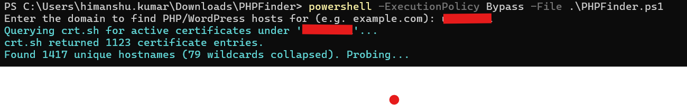
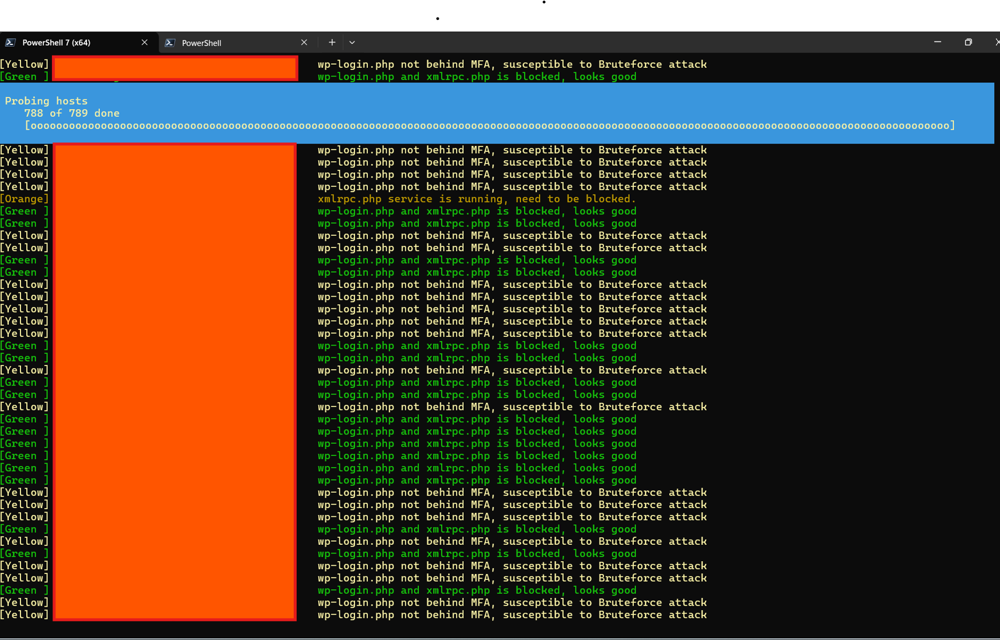

# PHPFinder Script
This PowerShell script in a simple solution to checks for all active SSL certificates for your organization by exporting JSON data from crt.sh, resolves each host, and probes common PHP paths over HTTPS to detect PHP (via the X-Powered-By, Server, and PHPSESSID headers), flag end-of-life versions, and export the PHP-positive hosts to an excel sheet (.xlsx).

# How to Run?
Download the script on your machine and run using below command:

```powershell -ExecutionPolicy Bypass -File .\phpfinder.ps1```

# Enter the root domain of your organization


# Snapshot of Script Output:


