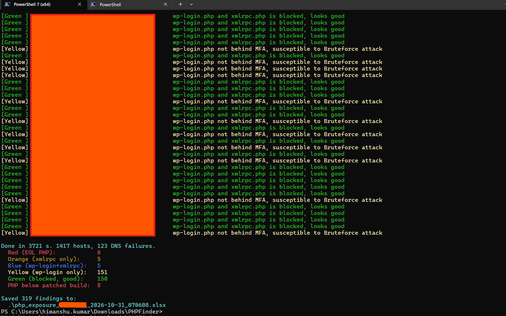
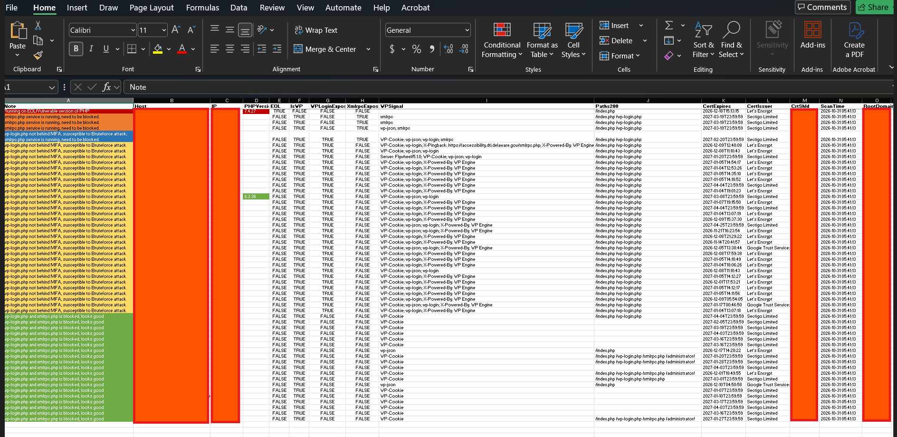

# PHPFinder Script
This PowerShell script provides a simpler and faster alternative to a vulnerability scanner for identifying active SSL-enabled hosts under your organization's root domain that may be vulnerable to the critical PHP vulnerabilities CVE-2026-109618 and CVE-2026-109619. The script exports JSON data for domains associated with your organization's public SSL certificates from crt.sh, resolves each host, and probes common PHP paths over HTTPS. It detects PHP through the X-Powered-By, Server, and PHPSESSID headers, identifies end-of-life PHP versions, and exports all PHP-positive hosts to an Excel spreadsheet (.xlsx).

# How to Run?
Download the script on your machine and run using below command:

```powershell -ExecutionPolicy Bypass -File .\phpfinder.ps1```

# Enter the root domain of your organization to find PHP vulnerabilities


# Advantage of using this script?
Fully automated, simple to use, higher detection accuracy and significantly faster (25 domains/minute) than traditional vulnerability scanning methods.

# Snapshot of Script Output:





